# Ödev 2: Öğrenci kartı

IEEE Hacettepe **Introduction to Python** dersinin 2. ödevi, Güz 2026.

<p align="center">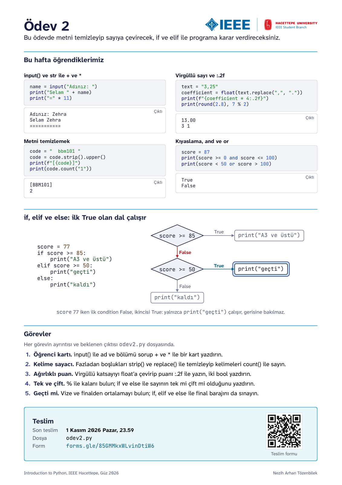</p>

Yukarıdaki kart bu haftanın özeti. Aşağıda aynı konuların daha ayrıntılı tekrarı var.

**İndirmek için:** yeşil **Code** düğmesine basın, **Download ZIP** deyin, zip'i açın. Git bilmenize gerek yok.

**Son teslim:** 1 Kasım 2026 Pazar, 23.59

**Teslim:** [Ödev 2 teslim formu](https://forms.gle/85GMMkxWLvinDtiW6)

Bu ödevin sonunda klavyeden okuduğunuz bilgiyi temizleyip doğru type'a (tip) çevirebilecek, kıyaslama ve `if`, `elif`, `else` ile programınıza karar verdirebileceksiniz.

## Bu ödevde kullanacaklarımız

### Reassignment
Bir variable'a (değişken) ikinci kez assignment (atama) yapınca isim artık yeni value'yu (değer) gösterir. Buna reassignment denir. `=` önce sağ tarafı hesapladığı için ismin eski value'sunu sağ tarafta kullanabilirsiniz.

```python
goals = 2
goals = goals + 1
print(goals)        # 3
```

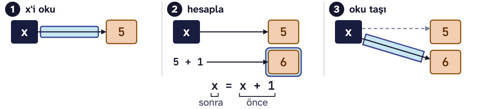

### str, + ve *
str (karakter dizisi), tırnak içine yazılmış metindir. `+` operator'ı (işlemci) iki str'yi arka arkaya ekler ve araya kendiliğinden boşluk koymaz. `*` ise bir str'yi verdiğiniz sayı kadar tekrar yazar.

```python
print("Hacettepe" + "Üniversitesi")         # HacettepeÜniversitesi
print("Hacettepe" + " " + "Üniversitesi")   # Hacettepe Üniversitesi
print("-" * 12)                             # ------------
print("G" + "o" * 10 + "l")                 # Gooooooooool
```

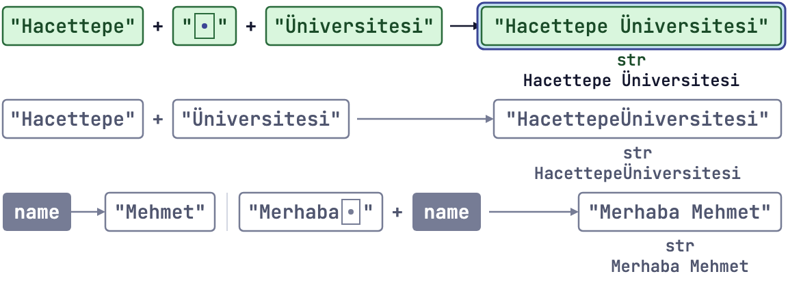

`print()`'teki virgül ile `+` aynı işi yapmaz:

| Yazılış | Çıktı | Neden |
|---|---|---|
| `print("Ders", "2")` | `Ders 2` | virgül araya bir boşluk koyar |
| `print("Ders" + "2")` | `Ders2` | `+` boşluk koymaz |
| `print("Ders " + "2")` | `Ders 2` | boşluk ilk str'nin içinde |

**Sık yapılan hata:** str ile bir sayıyı `+` ile birleştirmeye çalışmak. Python ne istediğinizi tahmin etmez, bir error message (hata mesajı) verir:

```text
print("Hacettepe" + 1)
TypeError: can only concatenate str (not "int") to str
```

İkisini yan yana yazdırmak için virgül yeter: `print("Hacettepe", 1)`.

### input()
`input()` parantez içindeki soruyu ekrana yazar ve sizin bir şey yazıp Enter'a basmanızı bekler. Yazdığınızı bir str olarak verir; onu kullanmak için bir isme bağlarsınız.

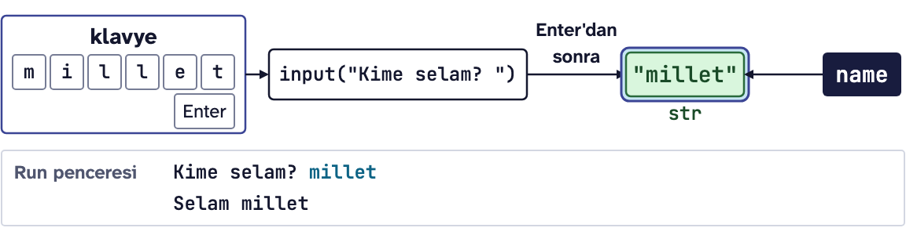

```python
city = input("Hangi şehirdesiniz? ")
print("Selamlar, " + city)
```

Run penceresinde:

```text
Hangi şehirdesiniz? Ankara
Selamlar, Ankara
```

PyCharm'da cevabı yazmadan önce Run penceresinin içine tıklayın; imleç editörde kalırsa yazdığınız şey koda gider. Program donmuş gibi görünüyorsa `input()` cevabınızı bekliyordur. Kırmızı **Stop** düğmesi programı durdurur.

**Sık yapılan hata:** Rakam yazılsa da `input()` her zaman str verir.

```python
teas = input("Kaç çay? ")      # 3 yazıldı
print(teas * 2)                # 33
print(type(teas))              # <class 'str'>
```

`teas * 2` 6 değil 33 yazdı, çünkü `teas` `"3"` str'ini gösteriyor ve `*` onu iki kez yan yana yazıyor. Hesap yapmak için önce sayıya çevirmeniz gerekir.

### Type conversion (tip çevirimi)
`int()`, `float()` ve `str()` verdiğiniz value'dan o type'ta yeni bir value üretir.

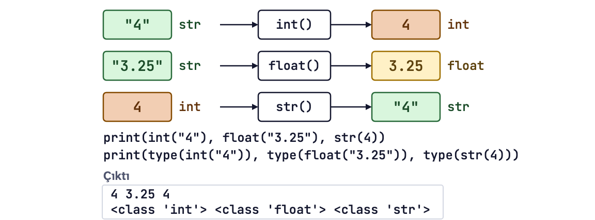

| Yazılış | Sonuç | Type |
|---|---|---|
| `int("42")` | `42` | int |
| `float("3.5")` | `3.5` | float |
| `str(42)` | `"42"` | str |
| `int(3.9)` | `3` | int, kesirli kısmı atar |
| `round(3.9)` | `4` | int, en yakın tam sayıya yuvarlar |

`input()` ile `int()` iç içe yazılabilir. Önce `input()` çalışır, sonra gelen str `int()` ile sayıya çevrilir:

```python
age = int(input("Yaşınız: "))
print("Gelecek yıl:", age + 1)
```

```text
Yaşınız: 19
Gelecek yıl: 20
```

`round()` tam yarımda çift sayıya gider: `round(2.5)` 2, `round(3.5)` 4 verir.

**Sık yapılan hatalar:**

Çevirimin sonucunu saklamamak. `int(age)` tek başına bir satırsa ürettiği sayıyı hiçbir isim göstermez ve sayı kaybolur; `age` hala str'dir. Hata mesajı da gelmez:

```python
age = input("Yaşınız: ")    # 19 yazıldı
int(age)
print(age * 2)              # 1919
```

Doğrusu `age = int(age)`.

Sayıya benzemeyen bir str'yi çevirmeye çalışmak. Python ondalık ayırıcı olarak yalnızca noktayı tanır:

```text
int("3.5")     ValueError: invalid literal for int() with base 10: '3.5'
float("3,5")   ValueError: could not convert string to float: '3,5'
```

### f-string
f-string, tırnaktan önce `f` yazılan bir str'dir. Süslü parantezlerin içine yazdığınız variable'ın ya da expression'ın (ifade) value'su metnin o yerine gelir. Sayıyı `str()` ile çevirmeye gerek kalmaz.

```python
name = "Zehra"
age = 19
print(f"{name} {age} yaşında, gelecek yıl {age + 1} olacak.")
# Zehra 19 yaşında, gelecek yıl 20 olacak.
```

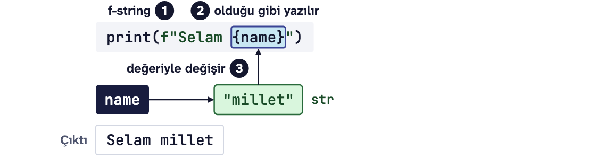

Süslü parantezde value'dan sonra `:.2f` yazarsanız sayı noktadan sonra iki basamakla gösterilir. Yalnızca gösterim değişir, variable'ın value'su aynı kalır.

```python
stage = 42.195 / 4
print(f"Her etap {stage:.2f} km")   # Her etap 10.55 km
print(stage)                        # 10.54875
```

| Yazılış | Çıktı |
|---|---|
| `f"{3.14159:.2f}"` | `3.14` |
| `f"{2.5:.2f}"` | `2.50` |
| `f"{7:.2f}"` | `7.00` |

**Sık yapılan hata:** `f` harfini unutmak. Hata mesajı gelmez, süslü parantezler olduğu gibi yazılır:

```python
name = "Ömer"
print("Sayın {name}")    # Sayın {name}
print(f"Sayın {name}")   # Sayın Ömer
```

### String methods (karakter dizisi metotları)
Method (metot), bir value'nun üzerinde nokta ile çağrılan bir işlemdir: `"ankara".upper()`. Parantezler boş olsa da yazılır.

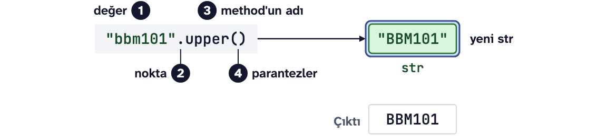

| Method | Ne yapar | Örnek | Sonuç |
|---|---|---|---|
| `strip()` | baştaki ve sondaki boşlukları siler | `"  ali  ".strip()` | `"ali"` |
| `upper()` | harfleri büyütür | `"ankara".upper()` | `"ANKARA"` |
| `lower()` | harfleri küçültür | `"HACETTEPE".lower()` | `"hacettepe"` |
| `replace(eski, yeni)` | her eskiyi yeniyle değiştirir | `"17-10-2026".replace("-", ".")` | `"17.10.2026"` |
| `count(parça)` | parçanın kaç kez geçtiğini sayar, int verir | `"Hacettepe".count("e")` | `3` |

Boşluklar ekranda görünmez. Bir str'nin nerede başlayıp nerede bittiğini görmek için onu köşeli parantez içinde yazdırın:

```python
word = "  ali  "
print(f"[{word}]")           # [  ali  ]
print(f"[{word.strip()}]")   # [ali]
```

Method'lar soldan sağa art arda çağrılabilir:

```python
city = "  ANKARA "
print(city.strip().lower())   # ankara
```

`upper()` ve `lower()` Türkçedeki i ve ı kuralını bilmez: `"i".upper()` noktalı İ değil, `I` verir.

### Immutable (değişmez) str
str immutable'dır (değişmez): bir method eski str'yi değiştirmez, yeni bir str üretir. Sonucu kullanmak istiyorsanız bir isme atayın. Aynı isme atarsanız isim yeni str'yi gösterir.

```python
city = "ankara"
city.upper()
print(city)          # ankara
city = city.upper()
print(city)          # ANKARA
```

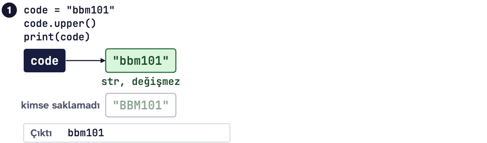

**Sık yapılan hata:** İkinci satırdaki gibi `city.upper()` yazıp `city`'nin büyüdüğünü sanmak. Hata mesajı gelmez, program eski value ile devam eder.

### Comparison operators (kıyaslama işlemcileri) ve bool
Comparison operator iki value'yu kıyaslar ve cevabı `True` ya da `False` olarak verir. Bu iki value'nun type'ı bool'dur (mantıksal tip).

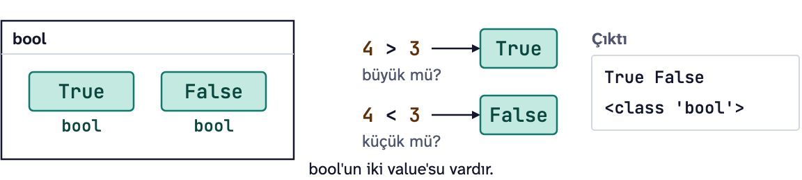

| Operator | Sorduğu | Örnek | Sonuç |
|---|---|---|---|
| `==` | eşit mi? | `7 == 7` | `True` |
| `!=` | eşit değil mi? | `7 != 7` | `False` |
| `<` | küçük mü? | `7 < 5` | `False` |
| `>` | büyük mü? | `7 > 5` | `True` |
| `<=` | küçük ya da eşit mi? | `7 <= 6` | `False` |
| `>=` | büyük ya da eşit mi? | `7 >= 7` | `True` |
| `in` | içinde geçiyor mu? | `"BBM" in "BBM101"` | `True` |

Kıyaslamanın sonucu da bir value'dur: doğrudan yazdırabilir ya da bir isme atayabilirsiniz. McLaren 2023'te dört lastiği 1.80 saniyede değiştirdi, önceki pit stop rekoru Red Bull'un 1.82'siydi:

```python
mclaren_2023 = 1.80
red_bull_2019 = 1.82
record = mclaren_2023 < red_bull_2019
print(record, type(record))    # True <class 'bool'>
```

`True` ve `False` büyük harfle ve tırnaksız yazılır. `"True"` tırnak içinde olduğu için bir str'dir.

**Sık yapılan hatalar:**

| Yazılış | Ne olur |
|---|---|
| `print(5 = 5)` | `SyntaxError: expression cannot contain assignment, perhaps you meant "=="?` Tek `=` assignment'tır, eşitlik `==` ile sorulur. |
| `"10" == 10` | Hata vermez, `False` der: str hiçbir zaman int'e eşit olmaz. `input()`'tan gelen sayıyı çevirmeyi unutursanız kıyaslama hep `False` çıkar. |
| `"85" > 50` | `TypeError: '>' not supported between instances of 'str' and 'int'` |
| `"OK" == "ok"` | `False`, çünkü büyük ve küçük harf farklıdır. |

### Logical operators (mantıksal işlemciler)
`and`, `or` ve `not` kıyaslamaları birleştirir. `and` iki taraf da True ise True verir, `or` için bir tarafın True olması yeter, `not` ise True'yu False'a, False'u True'ya çevirir.

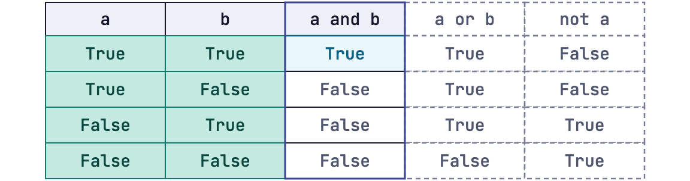

| `a` | `b` | `a and b` | `a or b` | `not a` |
|---|---|---|---|---|
| `True` | `True` | `True` | `True` | `False` |
| `True` | `False` | `False` | `True` | `False` |
| `False` | `True` | `False` | `True` | `True` |
| `False` | `False` | `False` | `False` | `True` |

Bir aralık, `and` ile bağlanan iki kıyaslamayla yazılır. Mesai 9'dan 18'e kadar olsun:

```python
hour = 14
print(hour >= 9 and hour < 18)    # True
hour = 20
print(hour >= 9 and hour < 18)    # False
```

Bir satırda hem `and` hem `or` varsa Python önce `and`'i yapar; karışmasın diye parantez yazın. Artık yıl kuralı da böyle yazılır: 4'e bölünen yıllar artık yıldır, ama 100'e bölünenler ancak 400'e de bölünüyorsa.

```python
year = 2024
div4 = year % 4 == 0
div100 = year % 100 == 0
div400 = year % 400 == 0
print((div4 and not div100) or div400)    # True
```

**Sık yapılan hatalar:**

`and`'in iki yanına da tam bir kıyaslama yazılır. Türkçede "9'dan büyük ve 18'den küçük" deriz, ama Python eksik kelimeyi tamamlamaz:

```text
print(hour >= 9 and < 18)
SyntaxError: invalid syntax
```

`or` için de aynısı geçerli, üstelik bu sefer hata mesajı bile gelmez:

```python
color = "yeşil"
print(color == "kırmızı" or "mavi")             # mavi
print(color == "kırmızı" or color == "mavi")    # False
```

İlk satırdaki `"mavi"` bir soru değil, bir str. Sol taraf False olunca `or` sağ tarafı olduğu gibi verir.

### if, else ve indentation (girinti)
`if` bir condition'a (şart) bakar. Condition True ise altındaki block (blok) çalışır, False ise Python o block'u atlar. `else`, condition False olunca çalışan öteki yoldur. İkisinden tam biri çalışır.

```text
if <şart>:
    <şart True ise çalışan satırlar>
else:
    <şart False ise çalışan satırlar>
```

```python
temperature = 12
if temperature < 15:
    print("Mont alın.")
else:
    print("Tişört yeter.")
print("İyi günler.")
```

```text
Mont alın.
İyi günler.
```

Block, iki noktadan sonra gelen ve indentation (girinti) ile, yani dört boşluk içeriden yazılan satırlardır. PyCharm iki noktadan sonra Enter'a basınca dört boşluğu kendisi koyar. Sol kenara dönen satır block'tan çıkmıştır ve her durumda çalışır, yukarıdaki `İyi günler.` gibi.

`else` zorunlu değildir. Condition False olduğunda yapılacak bir şey yoksa yazmayın.

**Sık yapılan hatalar:**

| Ne oldu | Error message |
|---|---|
| `if` satırının sonunda iki nokta yok | `SyntaxError: expected ':'` |
| `if`'ten sonraki satır içeride değil | `IndentationError: expected an indented block after 'if' statement on line 2` |
| Sebepsiz yere içeride yazılmış bir satır | `IndentationError: unexpected indent` |

Bu hatalardan biri varsa Python dosyanın hiçbir satırını çalıştırmaz. Satırları seçip Tab'a basarsanız içeri girer, Shift ile Tab'a basarsanız dışarı çıkar.

### elif
`elif`, Python'un "else if"idir ve üç ya da daha fazla yol olduğunda kullanılır. Python condition'ları yukarıdan aşağı sınar, ilk True olanın block'unu çalıştırır ve gerisine bakmaz bile. `if` bir tane olur, `elif` istediğiniz kadar, `else` en fazla bir tane.

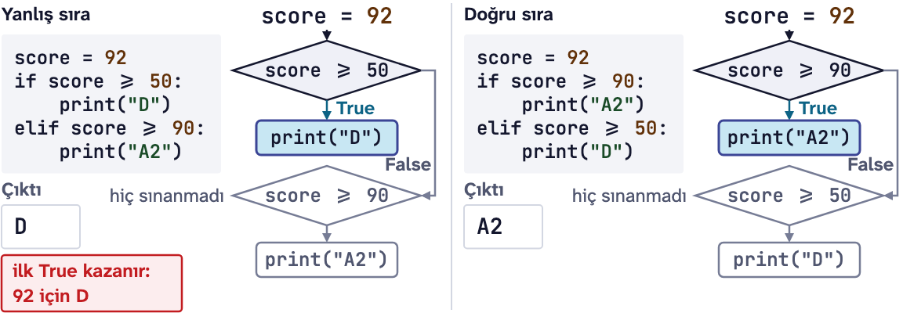

```python
temperature = 25
if temperature <= 0:
    print("buz")
elif temperature < 100:
    print("su")
else:
    print("buhar")
```

| `temperature` | İlk True olan | Çıktı |
|---|---|---|
| `-5` | `temperature <= 0` | `buz` |
| `25` | `temperature < 100` | `su` |
| `120` | hiçbiri, `else` çalışır | `buhar` |

İkinci condition'a alt sınır yazmadık, çünkü gerek yok: 25 oraya geldiyse ilk condition False çıkmıştır, yani 0'dan büyüktür.

**Sık yapılan hata:** Condition'ları yanlış sırayla yazmak. Hata mesajı gelmez, program sessizce yanlış yolu seçer:

```python
temperature = -5
if temperature < 100:
    print("su")
elif temperature <= 0:
    print("buz")
# Çıktı: su
```

-5 aynı zamanda 100'den de küçük olduğu için ilk condition True olur ve Python `elif`'e hiç bakmaz.

## Görevler

Görevlerin ayrıntısı ve her birinin beklenen çıktısı `odev2.py` dosyasının içinde.

1. **Öğrenci kartı:** Adı ve bölümü `input()` ile soracak, `+` ile birleştirip `"*" * 20` çizgileri arasında bir kart yazdıracaksınız.
2. **Kelime sayacı:** Fazladan boşluklu bir cümleyi `strip()` ve `replace()` ile temizleyecek, kelimeleri `count()` ile sayacak ve tek bir `replace()`'in neden yetmediğini comment olarak yazacaksınız.
3. **Ağırlıklı puan:** Ders kodunu temizleyecek, virgüllü katsayıyı float'a çevirip ağırlıklı puanı iki basamakla yazacak, dersin geçilip geçilmediğini ve katsayının geçerli olup olmadığını bool olarak yazdıracaksınız.
4. **Tek ve çift:** Klavyeden gelen sayının 2'ye bölümünden kalanı `%` ile bulacak, `if` ve `else` ile tek mi çift mi olduğunu yazdıracaksınız.
5. **Geçti mi:** Vize ve finalden ortalamayı `round()` ile bulacak, `if`, `elif` ve `else` ile hem final barajını hem ortalamayı sınayacaksınız. Condition'ların sırasına dikkat edin.

Zorunlu olmayan bir **Meraklısına** görevi de var: taş, kağıt, makas oyununda kazananı `and` ve `or` ile bulmak.

Sadece Ders 1 ve Ders 2'de gördüğümüz yapıları kullanın; `while` ve `for` Ders 3'te gelecek.

## Nasıl çalışılır

1. Zip'ten çıkan `odev2.py` ve `kontrol.py` dosyalarını aynı klasörde tutun ve `odev2.py`'yi PyCharm'da açın.
2. Her görevde `# TODO` satırının yerine kodunuzu yazın.
3. Dosyayı **Run** ile çalıştırın. `input()` soran görevlerde Run penceresine tıklayıp görevde yazan değerleri yazın ve Enter'a basın.
4. Çıktıyı görevin "Beklenen çıktı" kısmıyla karşılaştırın.

Dosya her çalıştığında bütün görevlerin sorularını baştan sorar. Bir görev üzerinde çalışırken öteki görevlerin kodunu seçip Ctrl+/ (macOS'ta Cmd+/) ile comment yapabilirsiniz; teslimden önce geri açın.

## Kendi kendinize kontrol

Bitirince `kontrol.py`'yi PyCharm'da açıp **Run** deyin. `input()` sorularını sizin yerinize görevlerde yazan değerlerle cevaplar, 4. ve 5. görevi öteki değerlerle de dener. Her görev için geçti ya da kaldı yazar, kaldıysa beklenen satırı ve sizin satırınızı gösterir. Kontrol not vermez, sadece size yol gösterir.

## Teslim

[Ödev 2 teslim formunda](https://forms.gle/85GMMkxWLvinDtiW6) "İsim" alanına isminizi yazın, `odev2.py`'yi "Ödev dosyası" alanına yükleyin ve "Kişisel verileriniz" sorusundaki onay kutusunu işaretleyin.

Takıldığınız bir yer olursa dersin WhatsApp grubuna yazın.

Dersin sitesi: https://natozenbilek.github.io/ieee-hacettepe-python-course/
